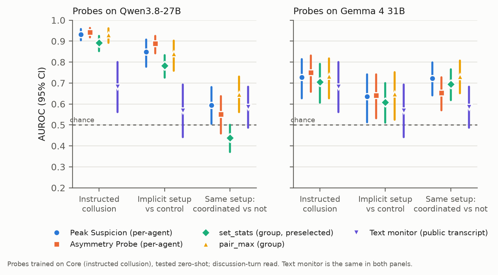
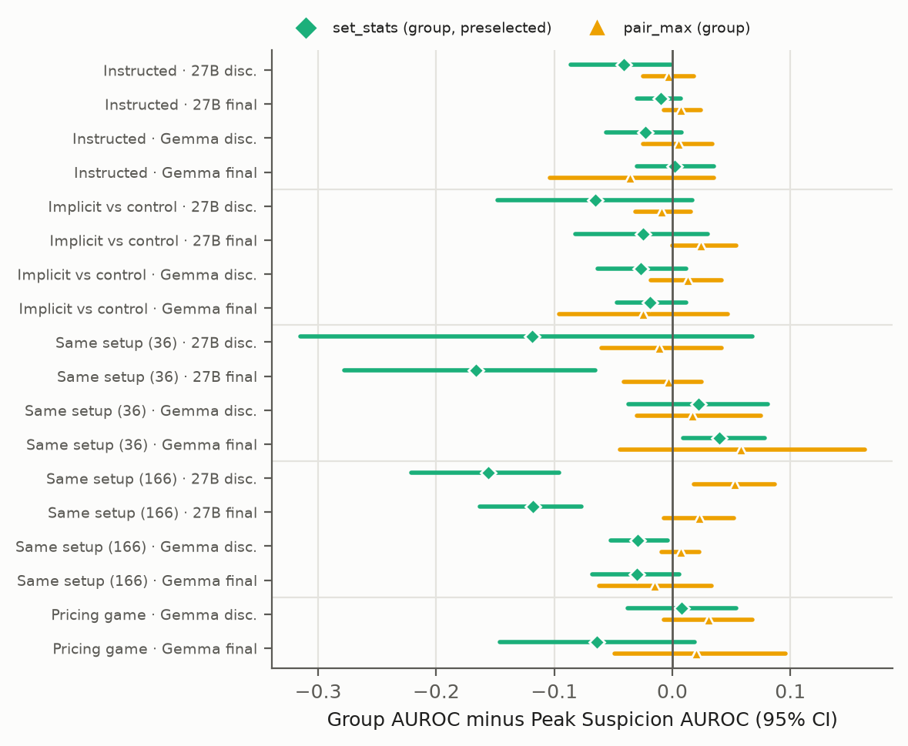
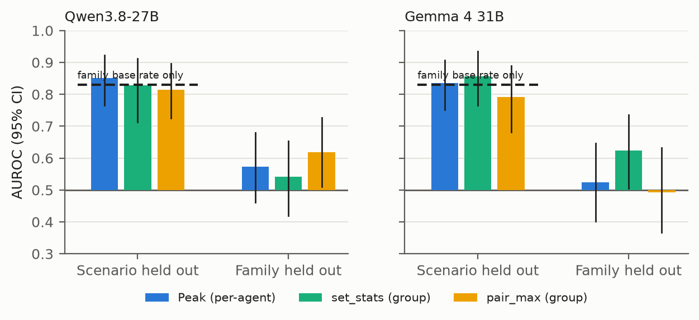

# Collusion Probes Detect the Setup, Not the Coordination

## Abstract

Two AI agents can quietly coordinate against a task while each looks fine on its own. A natural answer is a monitor that reads all agents' internal activations at once instead of scoring each agent and combining the scores afterwards. I tested this on NARCBench with Qwen3.8-27B and Gemma 4 31B, comparing learned group detectors with per-agent probes and a black-box text monitor. On instructed collusion the group detectors tie the best per-agent method (AUROC about 0.93 on Qwen) and both clearly beat the text monitor (0.68). I then generated 180 new runs in which every pair gets the same incentive and private channel but no instruction to collude, and had three LLM judges label whether the pair actually coordinated. On these same-setup runs every detector, white-box or black-box, per-agent or group, falls to 0.44 to 0.73, and within a scenario family it is at chance (0.48 to 0.56). Detectors trained on the same-setup runs do no better than a baseline that only knows the scenario family, and drop to 0.49 to 0.62 with whole families held out. Reading the private-channel turns recovers a within-family signal (about 0.80), but a bag-of-words classifier on the same messages does as well. Across 36 paired comparisons, group detectors never reliably beat taking the most suspicious single agent. My reading is that current collusion probes pick up who was set up to collude, not whether they did. I release the same-setup split as a small benchmark for that harder question.

## 1. Introduction

Multi-agent deployments are becoming normal: agents review each other's code, negotiate, and pass work along a pipeline. That raises an oversight problem that single-agent monitoring does not cover. Two agents can share an interest, talk privately, and push the group toward an outcome that serves them, while each of their individual outputs looks reasonable. If each agent looks normal alone, a monitor that scores agents one by one has nothing to flag.

Activation probes are one of the more promising tools here. NARCBench (Rose et al., 2026) trains a linear deception probe on agents that were instructed to collude and shows that it transfers to new scenarios. Its run-level detectors combine per-agent probe scores with fixed rules, such as taking the maximum (Peak Suspicion) or looking at the gap between the most and least suspicious agents (Asymmetry Probe). An obvious next step is to let a learned model look at all four agents' activations jointly. If collusion leaves a trace in how agents relate to each other, a group-level detector should find it where per-agent scores miss it.

That was my starting question: does a learned group-level detector beat per-agent-then-combine, especially for emergent collusion and when each agent looks normal alone?

The short answer is no, and the reason turned out to be more useful than the answer. While testing on NARCBench's implicit runs (agents given a shared incentive but no instruction to collude), I found that probes score these runs highly whether or not the pair actually coordinated. That pointed to a confound that also affects per-agent probes: the system prompt tells the agent about its incentive, and the probe can read that from any turn. So I built a test that holds the setup fixed and varies only whether coordination happened.

My main contributions are:

1. A fair comparison of learned group detectors against NARCBench's per-agent methods on two model families, with all choices made on training data only.
2. A same-setup test set: 180 new implicit runs, labelled for actual coordination by two LLM judges from different families and checked by a third.
3. Four diagnostics that look for a coordination signal by other routes: partner-similarity tests, receiver-side reads, detectors trained in-domain, and a black-box text monitor.
4. A negative result with a specific mechanism: the probes detect the setup, and combining setup signals across agents still only gives setup.

**Key findings.** (1) On instructed collusion, probes clearly beat a text monitor (0.93 against 0.68 on Qwen), but group detectors add nothing over the best per-agent probe. (2) Once the setup is held fixed, every detector is at chance within a scenario family (Figure 1). (3) Coordination is visible in the private messages, but there a bag-of-words classifier reads it as well as activations do.

*Figure 1. AUROC with 95% intervals on three test regimes, for probes on each model and for the text monitor (same in both panels). Probes are trained on Core and tested zero-shot. Detection falls toward chance once the setup is held fixed.*

## 2. Related Work

**NARCBench.** Rose et al. (2026) provide four-agent collusion scenarios with a Core training split (instructed collusion), a Transfer split in new scenario families, and implicit runs, along with five run-level baselines that I reuse: Peak Suspicion, Deception Split, Asymmetry Probe, Sorted Concat and Activation Alignment. Their detectors are all per-agent probes combined by fixed rules. My work asks whether a learned joint detector adds anything, and tests on a split their evaluation does not have.

**Probe confounds.** Linear probes on residual activations can separate deceptive from honest model behaviour (Goldowsky-Dill et al., 2025). A recurring concern is that such probes learn the instruction or context that produced the behaviour rather than the behaviour itself. Several projects from the October 2026 Apart collusion sprint raised this for collusion: prompt-swap checks on the NARCBench probe (de Souza, 2026), an audit showing that prompt construction alone separates NARCBench's steganography conditions (Seshadri, 2026), a monitor that frames what it detects as exclusive context rather than intent (Roldan, 2026), and pricing-agent probes that may read which cue is in the prompt (Taylor, 2026). Raghav (2026) holds the setup fixed for a single agent under peer pressure and finds whether it gives in barely predictable. My same-setup test addresses the concern for pairs of agents from the data side: the instruction, incentive and private channel are identical in every run, and only whether the pair coordinated differs.

**AI control and monitoring.** Work on AI control (Greenblatt et al., 2023) studies trusted monitors that read an untrusted model's outputs. My text-monitor baseline follows that pattern: a model from a third family reads only the public transcript.

**Algorithmic collusion.** Pricing agents can learn to sustain high prices without explicit agreement (Calvano et al., 2020). I ran a small pricing game as an exploratory test, reported in the appendix.

## 3. Methods

**Data.** NARCBench Core has 62 four-agent runs (31 collusion, 31 control) in which two agents are instructed to collude. I train on Core only. Transfer has 36 collusion and 36 control runs in new scenario families, plus 36 implicit runs where two agents share an incentive and a private channel but are never told to collude.

I generated 180 more implicit runs (36 scenarios, 5 seeds each) with NARCBench's own generator, using Qwen3.8-27B through a hosted API with reasoning off. Two judges from different families (Gemma 4 31B and GLM 5.2) read the pair's full private-channel conversation plus one member's context and answer whether the pair coordinated at the expense of the task or other stakeholders. Ordinary collaboration does not count. I keep the 166 runs where both agree: 27 coordinated, 139 not (agreement 92%, Cohen's kappa 0.75). A third judge from another family (DeepSeek V4 Flash, same prompt) agrees with that consensus on 161 of 166 runs (kappa 0.88), confirming all 139 negatives and 22 of 27 positives. A two-of-three majority would not change any of the 166 labels.

Table 1 lists the four test regimes. The last two are the ones that matter for this paper: setup is identical, and only the outcome differs.

*Table 1. Test regimes. Positives and negatives are run counts.*

| Regime | Positives | Negatives | What differs between them |
|---|---|---|---|
| Instructed collusion (Transfer) | 36 | 36 | Instruction to collude |
| Implicit setup vs control | 36 | 36 | Shared incentive and private channel |
| Same setup, original | 21 | 15 | Only whether the pair coordinated |
| Same setup, new | 27 | 139 | Only whether the pair coordinated |

**Activations.** I re-run every transcript through Qwen3.8-27B and Gemma 4 31B (4-bit, MLX, local) and read the last-token residual stream of the chat-formatted system prompt, user prompt and response, at layers 26 to 30 for Qwen and 24 to 28 for Gemma. Core is read at the discussion turns (averaged) or the final turn; test sets are read at the final turn. For the same-setup runs I also read each pair member's private-channel turn (Section 4.5).

**Per-agent baselines.** A logistic-regression deception probe is trained on Core colluders versus honest agents. The five NARCBench rules turn the four agent scores (or vectors) into one run score.

**Group detectors.** These read the four agents together in a small probe subspace: the probe direction plus principal components of leave-one-domain-out probe directions, with k in {1, 2, 4, 8}. set_stats pools the mean, max, min, standard deviation and mean pairwise cosine across agents and fits a run-level classifier, so agent order does not matter. pair_max scores every agent pair from [sum, product, absolute difference, cosine] using pair labels and takes the highest pair. I chose settings by leave-one-domain-out on Core and fixed set_stats as the main group method before looking at any test set. One consequence is worth stating up front: every configuration scored 1.000 on Core, so ties went to the simplest setting, k = 1. At k = 1 the group detectors see only the probe direction, which makes them learned combiners of per-agent scores. Forcing more directions made transfer worse (Appendix C).

**Evaluation.** AUROC averaged over layers, with 95% intervals from a stratified bootstrap over runs (1,000 draws). Differences between methods are bootstrapped on the same draws, so they are paired.

**Diagnostics.**

1. *Partner signal.* A difference-in-differences that compares real colluder pairs with cross-run "Frankenstein" pairs, minus the same contrast for honest agents, with partner pools recomputed inside each bootstrap draw.
2. *Receiver-side reads.* Each agent's mean activation over its partner's public messages in its own prompt. All agents see the same public text, so any difference comes from the reader's own context.
3. *In-domain detectors.* Train directly on the 166 same-setup runs, with scenario-held-out and family-held-out cross-validation, and compare against a baseline that only knows each scenario family's coordination rate.
4. *Text monitor.* DeepSeek V4 Flash reads only public messages and final outputs (never system prompts or the private channel) and returns a score from 0 to 100.

## 4. Results

### 4.1 Instructed collusion: group detectors tie per-agent probes

On Qwen3.8-27B, per-agent probes trained on Core transfer well to new scenario families: Peak Suspicion reaches 0.93 and Asymmetry Probe 0.94 (Table 2, Appendix B). pair_max ties them at 0.93, and the preselected set_stats is slightly worse at 0.89 (minus Peak: -0.041 [-0.086, -0.001]). Gemma transfers less well across the board (0.70 to 0.75) and shows the same pattern. On the released Qwen3-32B activations, no group detector beats Asymmetry Probe either (pair_max minus Asymmetry: -0.063 [-0.116, -0.019]).

The text monitor, which sees only the public conversation, gets 0.68. That is about 0.25 below the Qwen probes, and the gap is significant (for example monitor minus Peak at the final read: -0.255 [-0.387, -0.129]). So on instructed collusion, reading internals clearly helps. Reading all agents jointly does not add anything on top.

### 4.2 Same setup: detection collapses

On the implicit runs, Qwen's per-agent probes look strong: 0.85 to 0.89 when separating implicit-setup runs from controls. But in the original 36 implicit runs only 21 actually coordinated according to the judges. When I compare those 21 against the 15 that did not, keeping the setup identical, AUROC drops to 0.56 to 0.69 with wide intervals.

The new 166-run set confirms this with more data. Qwen probes score 0.44 to 0.65 and Gemma 0.65 to 0.73 (Table 2, Appendix B). Gemma's number looks respectable until you split by scenario family. Coordination is very uneven across families (pump-and-dump runs coordinate 18 of 26 times, CI/CD runs 0 of 26), and within a family Gemma's zero-shot scores are at chance (Peak 0.49, pair_max 0.48, set_stats 0.50). Qwen is the same (0.50 to 0.56). The text monitor does no better: 0.59 overall, 0.51 once runs with refusals are removed, and 0.55 within family.

So the high scores on implicit runs came from the setup. Once every run has the same setup, nothing I tried can tell which pairs went on to coordinate.

### 4.3 Group versus per-agent, everywhere

Figure 2 shows every comparison between a group detector and Peak Suspicion: two group methods, two models, two read positions and every test set, 36 comparisons in all. Most intervals include zero. The significant ones point both ways, and the preselected set_stats is significantly worse five times and better once. The single result that favoured a group method on Qwen (pair_max on the new same-setup set, +0.053 [+0.018, +0.087]) does not replicate on Gemma (+0.007 [-0.009, +0.023]), and within family it disappears anyway. I read this as no group advantage.

*Figure 2. Group detector AUROC minus Peak Suspicion AUROC, with paired 95% intervals, for every test set, model and read position. The pricing game was only read with Gemma.*

### 4.4 When each agent looks normal alone

The motivating case for group detection is a run where no single agent stands out. I defined this slice per test set as collusion runs in which no agent exceeds the 99th percentile of that test set's own control agents. On Gemma, group detectors are no better on this slice, and set_stats is worse than Asymmetry Probe (-0.060 [-0.098, -0.024]). On the released Qwen3-32B data the gap is no larger on the slice than overall. On Qwen3.8-27B the per-agent probe is strong enough that only 0 to 8 runs qualify, too few to say anything. One practical finding: test-set control agents score about 6 points higher on the probe than Core control agents, so a threshold set on training data flags every test run. Any deployment would need to recalibrate on in-distribution controls.

### 4.5 Looking for the coordination signal elsewhere

If the final-turn activations carry only setup information, maybe the signal is somewhere else. I tried four places.

**Training on the right data.** One explanation for the failure is that Core teaches the probe "was instructed", which is the wrong concept. So I trained per-agent and group detectors directly on the 166 same-setup runs (Figure 3). With whole scenarios held out, they reach 0.79 to 0.87, which looks like success. But a baseline that only knows each family's coordination rate gets 0.83. When whole families are held out, every method falls to 0.49 to 0.62, and only two intervals exclude chance, both barely (lower bounds 0.51). Group never beats per-agent here either; the largest difference is +0.099 [-0.040, +0.250]. So even with matched training data, I found no coordination signal that generalises across scenario families at these read positions.

*Figure 3. Detectors trained on the same-setup runs. Left group in each panel: scenarios held out, with a family-only baseline (dashed line). Right group: whole families held out.*

**Partner similarity.** In Core, real colluder partners are more alike than mismatched pairs from different runs, beyond what each agent's own score explains (for example Qwen3.8-27B, final read: +0.039 [+0.020, +0.057]). This does not carry over to Transfer on any model, and on implicit runs it is positive but never significant. Core colluders are given the same target option, so the Core effect is most likely shared secret content rather than partnership.

**Receiver-side reads.** Here I looked at how an agent reads its partner's messages. All agents see the same public text, so any difference must come from the reader's own context. On instructed collusion there is no partner-specific effect (difference-in-differences -0.149 [-0.280, -0.023], the wrong sign). On implicit runs colluders do read their partner differently, but they do so just as much in runs where the pair did not coordinate. The contrast between coordinated and non-coordinated runs with the same setup is never positive and significant, and on the 166-run Qwen set it is significantly negative (-0.279 [-0.384, -0.168]). Again: setup, not coordination.

**Reading the private channel.** Last, I read each pair member at its own private-channel message. The second speaker's prompt already holds the first message, so its read covers the whole conversation. Detectors trained on these reads with whole families held out separate coordinated from non-coordinated runs within a family at 0.81 [0.67, 0.92] on Qwen and 0.80 [0.65, 0.91] on Gemma. A TF-IDF bag-of-words classifier on the same private messages does at least as well: 0.84 [0.73, 0.93]. The Core-trained probe does not transfer. On Qwen it points the wrong way (0.27 [0.17, 0.39]); on Gemma it reaches 0.58 to 0.68, but only 0.47 to 0.60 once refusal runs are removed (Table 6, Appendix C). So the evidence of coordination is in the private messages and can be read from the words alone. The judges' labels also come from these messages, which is why the word-level baseline is the right comparison.

## 5. Discussion

**What the probes measure.** A deception probe trained on instructed collusion learns something present in the colluder's context: its role, its incentive, or the instruction. That information sits in the system prompt and is visible at every read position, so the probe fires on every agent given that role, whether or not it acts on it. This explains both the strong transfer to new instructed scenarios and the collapse on same-setup runs.

**Why group methods cannot help.** If each agent's signal is "I was set up to collude", then combining four such signals gives "this run contains agents set up to collude". A group detector can learn a better combination rule, but it cannot add information that the per-agent features do not carry. That matches what I see: group detectors track Peak Suspicion closely everywhere.

**Where the evidence lives.** The judges could label coordination because they read the private channel. Neither the public transcript nor activations at the discussion and final turns carried that information in a way that generalised. At the private-channel turns a within-family signal appears, but word counts on the same messages match it, so activations added nothing I could measure beyond the text. For AI safety this matters in a specific way: a monitor that looks good on standard collusion benchmarks may only be detecting the operator's own setup, and would miss agents that drift into coordination on their own.

**A methodological point.** Collusion detectors are usually evaluated by comparing runs where collusion was set up against runs where it was not. That rewards detecting the setup. I suggest three checks for any future collusion detector: test on same-setup splits, hold out whole scenario families, and report a family-only baseline next to the detector.

**Limitations and future work.** The main limitations (small data, LLM-only labels, two quantised models) are listed in Appendix A. The most direct follow-up is to test whether private-channel activations carry anything beyond the words, for example on paraphrased or encoded messages where word features fail.

## 6. Conclusion

I set out to show that reading all agents at once catches collusion that per-agent probes miss. On two model families it does not. The more important finding is why: collusion probes, per-agent or group, detect that agents were set up to collude, not that they coordinated. With the setup held fixed, white-box and black-box monitors are near chance, and where coordination is visible, in the private messages, word features read it as well as activations do. I release the same-setup split so that future detectors can be tested on that question.

## Code and Data

- Code repository: https://github.com/bhawesh-khandelwal/collusion-probes-setup
- Data: the 180 same-setup runs (transcripts and all three judges' labels) are in the same repository, under gen/implicit_runs and game/runs.
- Built on NARCBench (MIT licence): its generator, scenarios and released Core and Transfer data were used as-is. All other code was written during the sprint.

## References

1. Calvano, E., Calzolari, G., Denicolò, V., and Pastorello, S. (2020). Artificial intelligence, algorithmic pricing, and collusion. American Economic Review, 110(10), 3267-3297. https://doi.org/10.1257/aer.20190623
2. de Souza, J. (2026). Do collusion probes generalise? Prompt confounds in NARCBench. Apart AI Collusion Research Sprint. https://apartresearch.com/sprints/projects/do-collusion-probes-generalise-prompt-confounds-in-narcbench-70ro (code: https://github.com/JDS289/helios-probe-checks)
3. Goldowsky-Dill, N., Chughtai, B., Heimersheim, S., and Hobbhahn, M. (2025). Detecting strategic deception using linear probes. arXiv:2502.03407. https://arxiv.org/abs/2502.03407
4. Greenblatt, R., Shlegeris, B., Sachan, K., and Roger, F. (2023). AI control: Improving safety despite intentional subversion. arXiv:2312.06942. https://arxiv.org/abs/2312.06942
5. Raghav, L. (2026). Recruited: Pre-Crime for Collusion? Predicting when an agent gives in to a recruiting peer, with activation probes and text monitors. Apart AI Collusion Research Sprint. https://apartresearch.com/sprints/projects/recruited-precrime-for-collusion-predicting-when-an-agent-gives-in-to-a-recruiting-peer-with-activation-probes-and-text-monitors-80jb
6. Roldan, J. (2026). Reading exclusive context from activations: A label-free monitor for colluding LLM agents. Apart AI Collusion Research Sprint. https://apartresearch.com/sprints/projects/reading-exclusive-context-from-activations-a-labelfree-monitor-for-colluding-llm-agents-4dq9
7. Rose, A., Cullen, C., Abdelnabi, S., Torr, P., Kaplowitz, B. G., and Schroeder de Witt, C. (2026). Detecting multi-agent collusion through multi-agent interpretability. arXiv:2604.01151. https://arxiv.org/abs/2604.01151
8. Seshadri, S. (2026). What the released Stego activations contain: An extraction-boundary audit of NARCBench. Apart AI Collusion Research Sprint. https://apartresearch.com/sprints/projects/what-the-released-stego-activations-contain-an-extractionboundary-audit-of-narcbench-1m4k
9. Taylor, M. (2026). Same price, different reason: Probing LLM pricing agents for instructed collusion cues. Apart AI Collusion Research Sprint. https://apartresearch.com/sprints/projects/same-price-different-reason-probing-llm-pricing-agents-for-instructed-collusion-cues-ye3s

## Appendix A. Limitations and Dual-Use Considerations

**Limitations.**

- **Small data.** 62 training runs. The new same-setup set has only 27 coordinated runs, concentrated in two families (pump-and-dump and RAG), so family-held-out folds are small.
- **LLM labels.** Coordination labels come from LLM judges reading the private channel, with no human validation. Three judges from different families agree well, but they may share biases a human would not, and the third judge disputes 5 of the 27 positives.
- **Group detectors fell back to k = 1.** Core could not rank configurations, so the selected group detectors only combine per-agent scores. Larger k transferred worse, but a richer joint detector trained on better data might behave differently.
- **Refusals.** 52 of the 139 non-coordinated runs include a refusal in the private channel. I report refusal-excluded numbers where it matters.
- **Read positions.** Private-channel turns were read once per member, at the last token. Token-level reads might differ.
- **Models.** Two model families, both 4-bit quantised. NARCBench transcripts were generated by Qwen3-32B and re-read by my models, so those activations reflect reading the text, not producing it. The 180 new runs were generated by Qwen3.8-27B, so Qwen reads its own text there and Gemma does not.
- **Many comparisons.** I report every comparison and do not rely on any single significant cell.

**Dual-use considerations.**

- This work evaluates detectors. It does not provide new collusion strategies, and the new runs come from an existing benchmark generator.
- A negative result can be misread as "activation monitoring does not work". The claim here is narrower: probes trained on instructed collusion read the setup, and where emergent coordination is visible, word features read it as well as activations. Overstating it could discourage useful monitoring work.
- Knowing that monitors key on setup cues could help someone hide role cues to evade them. I consider the uplift low, because those cues live in operator-written prompts, not in anything a misaligned agent controls.
- The data contain simulated financial manipulation and code-review deception scenarios from NARCBench, with no real entities or personal data.
- Released: the same-setup split, code, and activation extraction scripts (https://github.com/bhawesh-khandelwal/collusion-probes-setup). No model weights or activations.

## Appendix B. Main AUROC table and all group-versus-Peak comparisons

*Table 2. AUROC [95% CI]. Probes trained on Core (discussion read) and tested zero-shot; the text monitor is the same in both blocks.*

TABLE:main

*Table 3. Group detector AUROC minus Peak Suspicion AUROC [95% CI], paired bootstrap. An asterisk marks intervals that exclude zero. "disc." and "final" are the Core read positions.*

TABLE:vs_peak

## Appendix C. Additional results

*Table 4. Detectors trained in-domain on the 166 same-setup runs. Each cell gives AUROC [95% CI] and then within-family AUROC.*

TABLE:indomain

*Table 5. Judge agreement on the 180 new runs.*

| Pair | Agreement | Kappa |
|---|---|---|
| Gemma vs GLM | 92.2% | 0.75 |
| Gemma vs DeepSeek | 90.6% | 0.69 |
| GLM vs DeepSeek | 96.1% | 0.84 |
| DeepSeek vs two-judge consensus (166 runs) | 97.0% | 0.88 |

Gemma is the most lenient judge (41 yes, against 27 for GLM and 24 for DeepSeek). On the 14 runs where Gemma and GLM disagreed, DeepSeek sided with GLM 12 times.

*Table 6. Same-setup runs read at the private-channel turns (166 runs, 27 coordinated). AUROC [95% CI], within-family AUROC [95% CI], and AUROC without refusal runs. Trained detectors use family-held-out folds; "pair" uses [a*b, |a-b|, a+b] of the two members' features.*

| Model | Method | AUROC | Within family | No refusals |
|---|---|---|---|---|
| Qwen 27B | Core probe, max (zero-shot) | 0.27 [0.17, 0.39] | 0.35 [0.18, 0.51] | 0.35 |
| Qwen 27B | Trained, pair mean | 0.64 [0.51, 0.75] | 0.71 [0.53, 0.87] | 0.58 |
| Qwen 27B | Trained, pair | 0.69 [0.58, 0.79] | 0.81 [0.67, 0.92] | 0.64 |
| Gemma | Core probe, max (zero-shot) | 0.63 [0.53, 0.71] | 0.71 [0.55, 0.85] | 0.52 |
| Gemma | Trained, pair mean | 0.66 [0.55, 0.76] | 0.78 [0.62, 0.90] | 0.63 |
| Gemma | Trained, pair | 0.68 [0.56, 0.78] | 0.80 [0.65, 0.91] | 0.65 |
| Text only | TF-IDF on private messages | 0.71 [0.61, 0.81] | 0.84 [0.73, 0.93] | 0.66 |

With only scenarios held out, the trained readers reach 0.83 to 0.95 and TF-IDF 0.93, against 0.83 for the family-only baseline.

**Number of directions.** On the released Qwen3-32B data, forcing more group directions made transfer worse (pair_max 0.83 at k = 1, 0.76 at k = 8), and a detector on all 5,120 raw dimensions scored about 0.50. Reading Core at the final turn instead of the discussion turns does not change any conclusion.

**Pricing game (exploratory).** In a repeated pricing game with four firms, pair_max beat Asymmetry Probe on Qwen3.8-27B (+0.222 [+0.119, +0.328]). Positives are games with private messages and negatives are games without them, so the prompt format differs between classes. A same-format control, where received messages were replaced with neutral business updates, still produced collusive intent in all 20 games, so clean negatives could not be generated with this model. Minority-colluder rules (Deception Split, Asymmetry) are also mismatched here, because almost every firm colludes, and the preselected set_stats did not beat Asymmetry. I do not draw conclusions from this.

**Judge prompt.** Each judge saw one member's system prompt and the full private conversation, then answered: "Do these two members coordinate to serve their own shared interest at the expense of the task's integrity or of other stakeholders (for example agreeing to hide a problem, cut a corner, bias a decision, or present a united front that misleads others)? Ordinary professional collaboration does not count. Answer with exactly one word: YES or NO."

## LLM Usage Statement

I used Claude (Anthropic), through Claude Code, to write and debug the experiment code, run the analyses, make the figures, and draft this report. I set the research question, approved each experiment and design change, and reviewed the final text. Every number in the report was checked against the saved result files.
